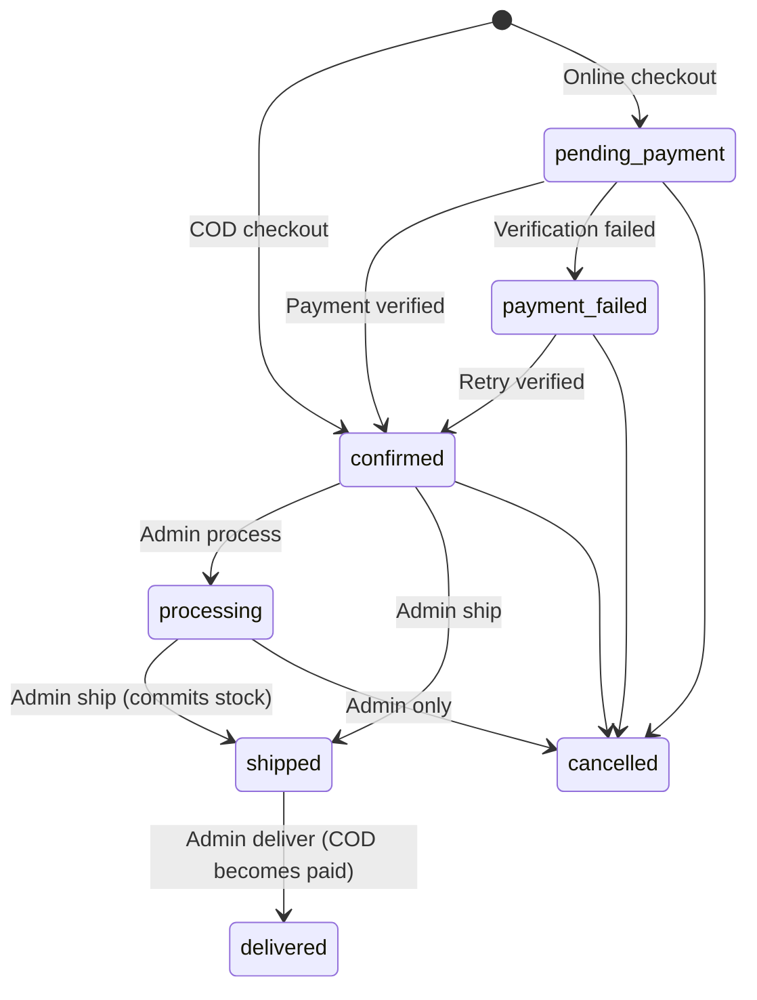

# Orders & Payments API

Backend modules: `apps/api/app/Modules/Orders` and `apps/api/app/Modules/Payments`.
All money is **integer BDT paisa** (`450000` = ৳4,500.00). Currency is always `BDT`.

---

## 1. Status Model (three independent axes)

Order status, payment status and fulfilment status are stored and transitioned **separately**. A payment arriving never re-opens a cancelled order, and a cancelled order never erases a real payment.

| Axis | Column | Values |
| :--- | :--- | :--- |
| Order | `orders.status` | `pending_payment`, `pending_confirmation`, `awaiting_payment`, `payment_failed`, `confirmed`, `processing`, `shipped`, `delivered`, `cancelled`, `returned` |
| Payment | `orders.payment_status` | `pending`, `cod_pending`, `awaiting_payment`, `paid`, `failed`, `partially_refunded`, `refunded` |
| Fulfilment | `orders.fulfilment_status` | `unfulfilled`, `fulfilled`, `delivered` |

> `formatOrder()` returns `status` **upper-cased** (e.g. `CONFIRMED`) to keep the existing storefront contract. `payment_status`, `fulfilment_status` and the values inside `status_histories` are lower-case.

### Order lifecycle



Every transition writes an immutable `order_status_histories` row (from/to of all three axes, actor type/id, reason, notes, metadata).

### Inventory side-effects (via `InventoryServiceContract` only)

| Transition | Effect |
| :--- | :--- |
| Checkout | Stock **reserved** (`quantity_reserved += qty`) |
| Cancel | Reservation **released** (`quantity_reserved -= qty`) |
| Ship | Reservation **committed** (`quantity_on_hand -= qty`, `quantity_reserved -= qty`) |

The Orders module never imports `App\Modules\Inventory\Models\*` (enforced by `InventoryIntegrationTest`).

---

## 2. Customer Order Endpoints (`auth:sanctum`)

| Method | Path | Description |
| :--- | :--- | :--- |
| `GET` | `/api/orders` | Authenticated customer's order history (newest first) |
| `GET` | `/api/account/orders` | Legacy alias (storefront account page) |
| `GET` | `/api/orders/{orderNumber}` | Order detail: item snapshots, status history, payment transactions |
| `POST` | `/api/orders/{orderNumber}/cancel` | Cancel before shipment; releases reserved stock |

**Authorization** — `OrderPolicy`: owners can view/cancel their orders; staff roles can view any order. Other customers receive `403`.

**Cancel request**
```json
{ "reason": "Changed delivery schedule", "notes": "optional, max 500" }
```
Customers may cancel in `pending`, `pending_confirmation`, `pending_payment`, `awaiting_payment`, `payment_failed`, `confirmed`. Otherwise `422` (`InvalidOrderStateException`). Cancelling an already-cancelled order is idempotent (`200`).

---

## 3. Admin Order Endpoints (`auth:sanctum` + `staff`)

| Method | Path | Body |
| :--- | :--- | :--- |
| `GET` | `/api/admin/orders` | Query: `status`, `payment_status`, `fulfilment_status`, `payment_method`, `search` (order number), `from_date`, `to_date`, `per_page` (1–100) |
| `GET` | `/api/admin/orders/{id}` | — |
| `POST` | `/api/admin/orders/{id}/confirm` | `notes?` |
| `POST` | `/api/admin/orders/{id}/process` | `notes?` |
| `POST` | `/api/admin/orders/{id}/ship` | `carrier?`, `tracking_number?`, `notes?` |
| `POST` | `/api/admin/orders/{id}/deliver` | `notes?` |
| `POST` | `/api/admin/orders/{id}/cancel` | `reason`, `notes?` |
| `POST` | `/api/admin/orders/{id}/refund` | `amount` (paisa, ≥1), `reason`, `idempotency_key?` (or `Idempotency-Key` header) |

All transitions lock the order row (`SELECT … FOR UPDATE`) and are idempotent when re-applied to the target state. List responses include `meta.current_page`, `last_page`, `per_page`, `total`.

### Required permissions

The `staff` middleware only proves the caller is staff; each action also needs a granular permission (checked with `$user->can()`; denied → `403`).

| Actions | Permission | Roles that hold it (default seeder) |
| :--- | :--- | :--- |
| `GET` list / detail | `orders.view` | `order_manager`, `customer_support`, `report_viewer`, `super_admin` |
| `confirm`, `process`, `ship`, `deliver`, `cancel` | `orders.manage` | `order_manager`, `super_admin` |
| `refund` | `payments.manage` | `super_admin` only (`order_manager` has `payments.view`) |

Customers calling `/api/admin/*` get `403`; unauthenticated callers get `401`.

### Order lookup by number (`GET /api/checkout/orders/{orderNumber}`)

Returns address and phone, so an order number alone is not enough:
- Orders owned by a customer: only that authenticated customer.
- Guest orders: only a caller sending the matching `X-Guest-Token`.
- Anyone else gets `404` (existence is not revealed). Rate limited to 60/min.

### Rate limits

| Route | Limit |
| :--- | :--- |
| `POST /api/payments/initiate` | 20/min |
| `POST /api/payments/verify` | 30/min |
| `GET`/`POST /api/payments/callback/{gateway}` | 60/min |
| `POST /api/webhooks/{gateway}` | 300/min (gateways retry in bursts) |

---

## 4. Payment Endpoints

| Method | Path | Auth | Description |
| :--- | :--- | :--- | :--- |
| `POST` | `/api/payments/initiate` | optional | Create a payment transaction and gateway session |
| `POST` | `/api/payments/verify` | optional | Server-side verification by reference |
| `GET`/`POST` | `/api/payments/callback/{gateway}` | none | Gateway redirect callback → server-side verification |
| `POST` | `/api/webhooks/{gateway}` | signature | Asynchronous IPN / webhook |

`{gateway}` ∈ `cod`, `bkash`, `nagad`, `sslcommerz`, `mock` (mock is **rejected in production**).

### Initiate
```json
{
  "order_number": "ORD-20261109-A0J0UL",
  "gateway": "bkash",
  "idempotency_key": "client-generated-uuid",
  "callback_url": "https://shop.example.com/checkout/return"
}
```
- `201` new transaction, `200` + `"idempotent_replay": true` for a repeated `idempotency_key`.
- `409` (`DuplicatePaymentException`) if the order is already paid.
- `422` if the order is cancelled.
- `502` if the gateway rejected the session.

Response: `data.transaction` (id, `merchant_reference`, gateway ids, amount, status …) and `data.redirect_url`.

### Verify
```json
{ "gateway": "bkash", "merchant_reference": "TXN-ORD-…", "payload": { } }
```
or `payment_id` instead of `merchant_reference`.

### Verification guarantees

Verification **always** calls the gateway's server API; the callback body is never trusted on its own. A transaction is only marked `paid` when all of these pass:

1. Gateway reports success (bKash `transactionStatus=Completed`, Nagad `status=Success`, SSLCommerz `VALID`/`VALIDATED`).
2. Merchant reference matches the transaction's `merchant_reference` or the order number.
3. Merchant / store id matches configuration (Nagad `merchantId`, SSLCommerz `store_id`).
4. Currency equals the order currency (`BDT`).
5. Amount equals `orders.total_amount` exactly (integer paisa).

Failures 2–5 return `422` with error key `payment_verification`; a gateway-declined payment returns `422` with key `payment`. The transaction is marked `failed` and a redacted copy of the verification exchange is stored.

### Idempotency & delayed callbacks

| Scenario | Behaviour |
| :--- | :--- |
| Repeated callback for a paid transaction | `200`, `idempotent_replay: true`, no state change |
| Repeated webhook (same `gateway` + `gateway_event_id`) | `200`, `idempotent_replay: true`; unique index on `payment_webhook_events` |
| Concurrent duplicate webhook | Unique-constraint race caught, returned as replay |
| Payment verified **after** order cancellation | Transaction `paid`, `orders.payment_status = paid`, order **stays** `cancelled`; transaction metadata `delayed_callback_on_cancelled_order: true`, `requires_manual_refund: true` |

No database lock is held during any outbound gateway HTTP call: the transaction is created in a short transaction, the gateway is called, then results are applied in a second locked transaction.

### Webhook signatures

When `<GATEWAY>_WEBHOOK_SECRET` is configured, the request must carry an HMAC-SHA256 of the raw body in `X-Signature` (or `X-Bkash-Signature` / `X-Nagad-Signature` / `X-Sslcommerz-Signature` / `X-Mock-Signature`). Missing or invalid signatures return `400` before any state change.

---

## 5. Gateway Adapters

All adapters implement `App\Shared\Contracts\Payments\PaymentGateway` (`initiate`, `verify`, `refund`, `parseWebhook`) and are resolved by `PaymentGatewayFactory`.

| Adapter | Reference API | Notes |
| :--- | :--- | :--- |
| `BkashGatewayAdapter` | bKash Tokenized Checkout `v1.2.0-beta` | Token grant → create → execute; refund via `/payment/refund` |
| `NagadGatewayAdapter` | Nagad Merchant Checkout `v-0.2.0` | Verify via `GET /api/dfs/verify/payment/{paymentRefId}` |
| `SslCommerzGatewayAdapter` | SSLCommerz `v4` | Session via `/gwprocess/v4/api.php`; validate via `validationserverAPI.php` |
| `CodGatewayAdapter` | — | Marks `cod_pending`; becomes `paid` on delivery |
| `MockPaymentGatewayAdapter` | — | Deterministic test adapter. Throws `PaymentConfigurationException` when `APP_ENV=production` or `PAYMENT_ALLOW_MOCK_GATEWAY=false` |

> [!IMPORTANT]
> Adapter request/response shapes follow the publicly documented merchant APIs. Before going live, validate each adapter against the merchant documentation and sandbox credentials issued to your account — providers change field names and signing requirements between versions. Nagad's production flow additionally requires RSA-encrypted `sensitiveData` with merchant keys issued by Nagad.

---

## 6. Audit Trail & Redaction

- `payment_gateway_logs`: every outbound gateway request/response (endpoint, method, HTTP status, duration, payloads).
- `payment_transactions.raw_*`: initiation and verification exchanges.
- `payment_webhook_events`: inbound payloads and headers.
- `payment_refunds.raw_*`: refund exchanges.

All are passed through `SensitiveDataRedactor` first, which replaces values of keys such as `password`, `store_passwd`, `app_key`, `app_secret`, `authorization`, `id_token`, `refresh_token`, any `*token*`, `*secret*`, `*signature*`, `private_key`, card data, PIN/OTP, and any `Bearer …` / PEM value with `[REDACTED]`.

Gateway credentials live only in environment variables (`config/payment.php`) and are never returned by any endpoint.

---

## 7. Refunds (foundation)

`POST /api/admin/orders/{id}/refund` refunds against the latest `paid` / `partially_refunded` transaction:

- Idempotent per `idempotency_key` (unique on `payment_refunds`).
- Rejects amounts ≤ 0 or above the remaining refundable balance (`422`).
- Gateway call happens outside the DB transaction; on success, `refunded_amount`, transaction status and `orders.payment_status` (`partially_refunded` / `refunded`) are updated under row locks, and a status history row plus `RefundProcessed` event are recorded.

---

## 8. Configuration

| Variable | Purpose |
| :--- | :--- |
| `PAYMENT_ALLOW_MOCK_GATEWAY` | Defaults to `true` outside production; must be `false` in production |
| `BKASH_SANDBOX`, `BKASH_BASE_URL`, `BKASH_APP_KEY`, `BKASH_APP_SECRET`, `BKASH_USERNAME`, `BKASH_PASSWORD`, `BKASH_CALLBACK_URL`, `BKASH_WEBHOOK_SECRET` | bKash |
| `NAGAD_SANDBOX`, `NAGAD_BASE_URL`, `NAGAD_MERCHANT_ID`, `NAGAD_MERCHANT_NUMBER`, `NAGAD_PRIVATE_KEY`, `NAGAD_PUBLIC_KEY`, `NAGAD_CALLBACK_URL`, `NAGAD_WEBHOOK_SECRET` | Nagad |
| `SSLCOMMERZ_SANDBOX`, `SSLCOMMERZ_BASE_URL`, `SSLCOMMERZ_STORE_ID`, `SSLCOMMERZ_STORE_PASSWORD`, `SSLCOMMERZ_SUCCESS_URL`, `SSLCOMMERZ_FAIL_URL`, `SSLCOMMERZ_CANCEL_URL`, `SSLCOMMERZ_IPN_URL`, `SSLCOMMERZ_WEBHOOK_SECRET` | SSLCommerz |
| `MOCK_GATEWAY_WEBHOOK_SECRET`, `MOCK_GATEWAY_MERCHANT_ID` | Mock (tests only) |

See `.env.example`, `.env.development.example`, `.env.production.example` for placeholders and `apps/api/config/payment.php` for the authoritative list.

---

## 9. Tests

| Suite | Coverage |
| :--- | :--- |
| `tests/Feature/OrdersAndPayments/OrdersAndPaymentsTest.php` (11 tests) | Order number & snapshots, history, ownership authorization, cancel → stock release, admin lifecycle → stock commit & COD collection, bKash / SSLCommerz / Nagad flows via `Http::fake()`, credential redaction, idempotent initiation / callbacks / signed webhooks, forged signature rejection, duplicate payment `409`, amount / currency / reference mismatch, delayed callback after cancellation, partial refund, granular admin permissions (view / manage / refund), order-lookup privacy for customer and guest orders |
| `tests/Unit/OrdersAndPayments/OrdersAndPaymentsUnitTest.php` (3 tests) | Redactor, mock gateway production guard, `OrderPolicy` |
